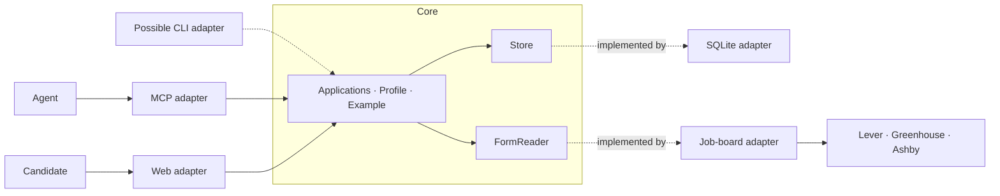

# Dossier

Tailor every job application with your own AI.

Dossier is a local app for preparing job applications with the AI chat you already use, such as Claude Code or Codex. Your Agent reads the posting and drafts the answers and résumé; Dossier stores them and shows each application on one page, where you review and edit everything before you send it.

- **Your context.** Write your profile once (career history, accomplishments, base résumé, voice), so every draft starts from what's true.
- **Your judgment.** Highlight what you like in a posting and note why. You apply to fewer jobs, each one on purpose.
- **Your review.** The posting, the form's answers and the résumé sit side by side. Edit anything before it goes out.
- **Your AI.** Use Claude or Codex, the one you already pay for. No new subscription, no API key.
- **Your computer.** Everything stays in one local file.

Landing page: https://dossier.victorc.dev

## How it works

Dossier has no AI of its own. It runs a small server on your computer that does three things:

- serves the pages at `http://localhost:4747`,
- stores your profile and applications in a SQLite file at `data/dossier.db`,
- exposes tools to your Agent over MCP at `http://localhost:4747/mcp`.

Your Agent does the reading, research and writing through those tools, and the page updates live as it works. The MCP server also tells your Agent how to work with you: ask before drafting, one piece at a time, and check every claim against your profile or what you said.

## Requirements

- Node.js 24 (the exact version is in `.node-version`)
- An Agent that supports MCP over HTTP, such as Claude Code or Codex

## Install

```sh
git clone https://github.com/victorcheeney/dossier.git
cd dossier
npm install
npm start
```

Open http://localhost:4747. Set `PORT` to use another port.

## Connect your Agent

With Dossier running, add it to your Agent once.

Claude Code:

```sh
claude mcp add --transport http dossier http://localhost:4747/mcp
```

Codex:

```sh
codex mcp add dossier --url http://localhost:4747/mcp
```

`npm start` prints the same commands, with your port.

## First steps

1. **Try the Example.** On the first page, click "Try the Example" to load a made-up candidate, Alex Martin, with a full profile and an application for a Product Engineer posting at Acme. Remove it in one click when you're done.
2. **Build your profile.** Ask your Agent to help you build your Dossier profile. It asks where your past work lives (a résumé, LinkedIn, GitHub, past reviews, or your own words) and drafts each document for you to check: career history, accomplishments, base résumé, voice, criteria and stories.
3. **Paste a posting.** Paste a job posting or its link in your Agent's chat. It adds the application, reads the form's questions, checks the posting against your criteria and asks what each answer should say. Highlight what matters to you on the page, edit the drafts, and click "Download PDF" to print the résumé from your browser.

## Tools

What your Agent can do in Dossier:

| Tool | What it does |
| --- | --- |
| `read_form_fields` | Reads the questions of a public Lever, Greenhouse or Ashby application form. |
| `get_profile` | Reads your profile documents. |
| `set_profile_document` | Creates or replaces a profile document. |
| `edit_profile_document` | Changes one passage of a profile document. |
| `delete_profile_document` | Deletes a profile document, when you ask. |
| `add_application` | Adds an application for a posting, with its full text and form questions. |
| `update_application` | Changes an application's details or questions. |
| `list_applications` | Lists applications, newest first, optionally by stage. |
| `get_application` | Reads one application: posting, answers, résumé, stage, summary, research, notes and your highlights. |
| `set_stage` | Moves an application to Preparing, Applied, Interviewing, Offer or Closed. |
| `set_answer` | Writes the answer to one question. |
| `set_resume` | Replaces the application's tailored résumé and warns when it runs past one page. |
| `set_summary` | Writes a short summary of the posting. |
| `set_research` | Writes what it found about the employer beyond the posting. |
| `add_note` | Adds a dated note, such as its view of the posting or an interview invite it read. |

## Privacy

- Your profile and applications live only in `data/dossier.db` on your computer. Git ignores the `data/` folder.
- The server listens on `127.0.0.1` and answers only requests addressed to localhost.
- Dossier sends nothing anywhere. The one request it makes itself is `read_form_fields`, which downloads a public application form from Lever, Greenhouse or Ashby.
- Your Agent sees what it reads through the tools, as with anything else you share with it. What it fetches or sends is up to your Agent and you.

## Architecture

I built Dossier for both a person and their Agent. The Agent drafts Answers through MCP; the Candidate edits them on the page. Both should follow the same rules. If I add a CLI later, it should get those rules too.

That is why Dossier uses **ports and adapters**. The core owns the rules, and adapters translate between the core and a technology. The folders make that split visible:



**Driving adapters call the core.** MCP translates tool arguments and results. The web adapter handles HTTP, HTML and live events. Their driving ports are the use-case functions the core exposes, such as `applications.setAnswer` and `profile.edit`.

**Driven adapters implement interfaces the core owns.** SQLite implements `Store`; the job-board reader implements `FormReader`. The core imports neither adapter. `src/server.ts` supplies them explicitly:

```ts
const store = openSqliteStore(dbPath);
const core = createCore({ store, formReader: jobBoards(fetch) });
```

There is no dependency-injection framework. Plain TypeScript interfaces and function arguments keep the wiring easy to follow. The full layout is small:

```text
src/
├── core/
│   ├── index.ts          # createCore: the driving ports
│   ├── applications.ts   # Answers, Stages, Notes, Highlights
│   ├── profile.ts        # named documents and passage edits
│   ├── resume.ts         # content sanitizing and overflow warning
│   ├── example.ts        # loading and removing the Example
│   ├── domain.ts         # types and domain errors
│   └── ports.ts          # Store and FormReader
├── adapters/
│   ├── mcp.ts            # driving: Agent tools
│   ├── web/              # driving: routes, pages and SSE
│   ├── sqlite.ts         # driven: persistence and change notices
│   ├── job-boards.ts     # driven: public form reading
│   └── example-files.ts  # reads the bundled Example
└── server.ts             # creates and connects the adapters
```

### One rule, both callers

For example, `applications.addNote` checks that the Application exists, refuses blank text, trims the text and source, then saves the Note. MCP and HTTP call that same function. A `Refusal` becomes an MCP tool error or HTTP 400; a `NotFound` becomes a tool error or HTTP 404. A taken Profile document name keeps HTTP 409. The core owns the message; adapters can add instructions for recovering, such as the available Field labels.

The Profile and Applications meet in one place: a new Application copies the Base résumé. Later Profile edits leave that copy alone. Résumé sanitizing and the one-page estimate also belong to the core; rendering and printing belong to the web adapter.

This is the part of designing for agents that matters to me: the Agent has its own way into the app, alongside the Candidate's page. Adding that way in should reuse the behavior already there. A new adapter still needs argument parsing, result formatting and tests, but it does not need to reimplement the rules.

### Live pages

Each open Application page subscribes through `core.applications.subscribe`; the Profile page uses `core.profile.subscribe`. SQLite notifies listeners after a write commits. The web adapter sends that notice over **Server-Sent Events (SSE)**, a long-lived HTTP connection from the server to the browser. The browser fetches fresh HTML and updates the page while leaving the box being typed in alone.

The Store stays a driven adapter: the core calls it to save data or register a listener, and callbacks carry change notices back out. Keeping subscriptions on Store means writes and their notices live together. That also means another Store implementation would need to provide change notices. There is no separate event bus.

### Testing the seams

Rule tests call `createCore` directly with a fresh SQLite `:memory:` database. They exercise saved results and refusals without starting HTTP or MCP, while still using real SQL. Adapter tests cover tool errors, HTTP responses, rendered pages, persistence, SSE and saved public job-board responses. A rule gets one core test; adapter tests check the translation and behavior visible to their callers.

The decision and trade-offs are recorded in [ADR 0002](docs/adr/0002-ports-and-adapters.md).

## Development

```sh
npm test
```

Node runs the TypeScript directly; there is no build step. Read [AGENTS.md](AGENTS.md) for the layout and conventions, [GLOSSARY.md](GLOSSARY.md) for the terms, and [docs/design.md](docs/design.md) for the design decisions.

## License

[MIT](LICENSE)
